<!--
文件用途：
说明 Linux Server Inspector 的模块划分、文件调用关系、
数据格式，以及新增功能时需要连接的位置。

整体执行流程：
手动启动或 cron 触发
  ↓
server_check.sh 检查环境、获取锁、准备日志
  ↓
main.py 读取配置，组织各模块检查
  ↓
collector.py 调用 Shell 脚本，解析采集输出
  ↓
各分析模块把采集数据转换成检查结果
  ↓
汇总状态，reporter.py 生成中文报告
  ↓
报告保存成功后，原子保存最近巡检快照
  ↓
notifier.py 使用同一批内存结果尝试通知
  ↓
入口脚本记录退出码并释放锁

主要数据：
config：YAML 配置转换后的字典。
collected：一次采集的结果字典。
data：采集结果中的字段和值，目前值主要为字符串。
check：一条分析结果。
checks：全部分析结果组成的列表。
system_info：报告使用的主机基本信息。
latest_inspection：清理通知读取的最近巡检快照。
alert_state：活动故障及最近成功发送时间。
-->

# Linux Server Inspector 架构说明

## 1. 项目由哪些部分组成

项目分为六个部分：

| 部分 | 主要文件 | 负责什么 |
|---|---|---|
| 启动与调度 | `server_check.sh`、`inspector.cron` | 何时启动、防止重复运行、记录运行过程 |
| 数据采集 | `collector.py`、`scripts/*.sh` | 执行系统查询，把输出整理成数据 |
| 规则分析 | `analyzer.py`、三个独立分析模块 | 根据配置判断 PASS、WARN、FAIL |
| 结果展示 | `reporter.py` | 生成中文 TXT 报告 |
| 外部通知 | `notifier.py` | 钉钉消息、稳定故障标识、重复抑制和原子状态 |
| 文件维护 | `cleanup.py`、`inspector.logrotate` | 清理过期文件、轮转累计日志 |

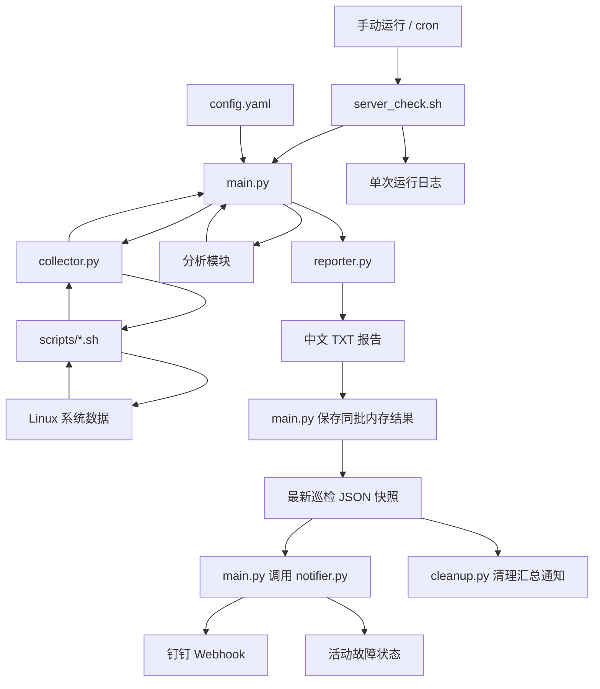

`main.py` 是组织者：它调用采集函数，把采集结果交给分析函数，再将全部检查结果交给报告函数。

Shell 负责查询系统，Python 负责解析和判断。

## 2. 文件与职责对应

### 2.1 配置、入口和 Python 文件

| 文件 | 主要职责 | 主要联系 |
|---|---|---|
| `config/config.yaml` | 保存阈值、检查对象、开关和输出目录 | 被主程序、启动脚本内嵌 Python、清理工具读取 |
| `config/inspector.cron` | 保存巡检和清理时间规则 | 部署到 `/etc/cron.d/` 后由 crond 读取 |
| `config/inspector.logrotate` | 保存日志轮转规则 | 部署到 `/etc/logrotate.d/` 后由 logrotate 读取 |
| `server_check.sh` | 检查环境、获取锁、调用 Python、记录日志 | 启动 `main.py` |
| `src/main.py` | 连接全部巡检模块 | 调用采集、分析、报告、通知函数 |
| `src/collector.py` | 调用允许执行的 Shell 脚本 | 返回统一采集结果 |
| `src/analyzer.py` | 资源、进程、服务分析与公共函数 | 也被其他分析模块及报告模块导入 |
| `src/network_analyzer.py` | 分析 TCP 监听端口 | 使用公共分析函数 |
| `src/security_analyzer.py` | 分析 firewalld 与 SSH 配置 | 使用公共分析函数 |
| `src/log_analyzer.py` | 解析日志、识别错误和认证失败 | 使用公共分析函数 |
| `src/reporter.py` | 校验报告输入、排版、保存文件 | 使用 `summarize()` 汇总状态 |
| `src/notifier.py` | 筛选告警、去重、加签和发送 | 直接接收 `system_info`、`checks` 和配置 |
| `src/cleanup.py` | 扫描和删除过期报告、单次日志，按显式参数发送清理汇总 | 独立调度；通知时读取最近巡检 JSON 快照 |

### 2.2 Shell 采集文件

| 文件 | 数据来源或命令 | 交给哪个模块处理 |
|---|---|---|
| `system_info.sh` | 系统版本、主机名、内核、运行时长等 | `main.py` |
| `cpu.sh` | `/proc/stat` 等 | `analyzer.py` |
| `memory.sh` | `/proc/meminfo` | `analyzer.py` |
| `disk.sh` | `df` | `analyzer.py` |
| `process.sh` | `ps` | `analyzer.py` |
| `service.sh` | `systemctl show` | `analyzer.py` |
| `network.sh` | `ip`、`ss` | `network_analyzer.py` |
| `security.sh` | `firewall-cmd`、`sshd -T` | `security_analyzer.py` |
| `log.sh` | `journalctl` | `log_analyzer.py` |

`scripts/setup_yum_repo.sh` 是环境准备工具，不属于日常巡检，也不在采集脚本白名单中。

## 3. 一次巡检怎样执行

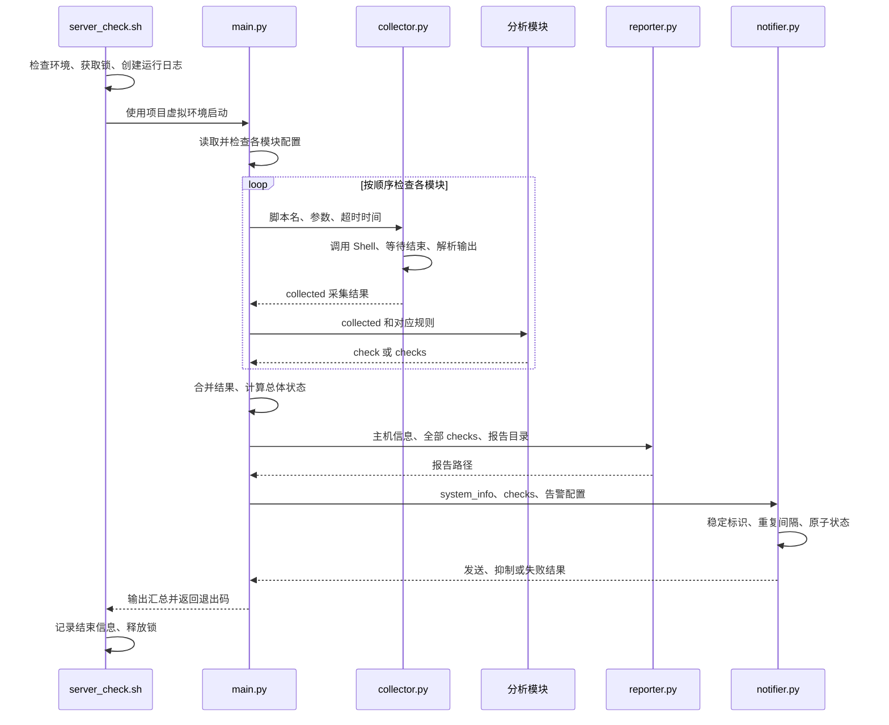

当前按顺序执行，不并行采集。

通知严格位于报告保存之后。通知失败会写入运行日志，但不会删除报告、覆盖检查结果或改变由检查状态决定的入口退出码。

系统基本信息由 `main.py` 自己检查；其他项目交给对应分析函数。

## 4. 数据怎样一步步变化

数据主要经过四种形式：

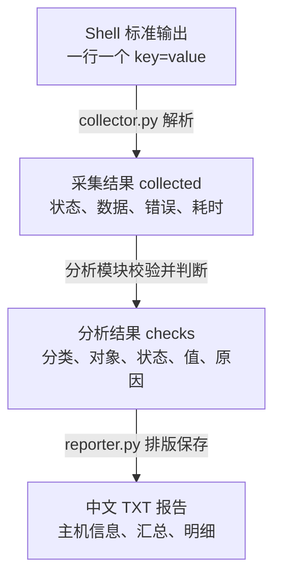

### 4.1 Shell 输出：key=value

以 CPU 为例：

```text
cpu_usage_percent=12.50
cpu_cores=8
load_1=0.13
load_5=0.06
load_15=0.05
sample_seconds=1
```

约定：

- 一行一个字段。
- 第一个 `=` 左边为字段名，右边为值。
- 标准输出用于数据，错误说明写入标准错误。
- 不应在标准输出混入“正在检查”等提示文字。
- 同一次输出不能出现重复字段名。

`collector.py` 按第一个 `=` 分割，因此值中仍然可以包含 `=`。

### 4.2 collector.py 返回：采集结果字典

```json
{
  "script": "cpu.sh",
  "ok": true,
  "returncode": 0,
  "data": {
    "cpu_usage_percent": "12.50",
    "cpu_cores": "8",
    "load_1": "0.13",
    "load_5": "0.06",
    "load_15": "0.05",
    "sample_seconds": "1"
  },
  "stderr": "",
  "error": "",
  "duration_seconds": 1.02
}
```

| 字段 | 含义 |
|---|---|
| `script` | 调用的脚本名 |
| `ok` | 脚本执行和输出解析是否成功 |
| `returncode` | Shell 进程退出码，未启动时可能为空 |
| `data` | 解析后的采集数据 |
| `stderr` | 脚本错误输出 |
| `error` | 采集器记录的失败原因 |
| `duration_seconds` | 本次采集耗时 |

**`ok=true` 只说明采集成功，不说明服务器检查通过。**

例如，CPU 使用率 95% 仍可以被成功采集，然后由分析模块判为 FAIL。

`data` 中的 `"12.50"` 此时仍是字符串，分析时才转换为数值。

### 4.3 分析模块返回：统一检查结果

```json
{
  "category": "cpu",
  "target": "CPU",
  "status": "PASS",
  "value": 12.5,
  "reason": "使用率低于警告阈值 70%"
}
```

| 字段 | 含义 | 示例 |
|---|---|---|
| `category` | 检查分类 | `cpu`、`network`、`logs` |
| `target` | 具体对象 | `CPU`、`/boot`、`sshd.service` |
| `status` | 检查状态 | `PASS`、`WARN`、`FAIL` |
| `value` | 用于展示的实际值 | 数字、字符串、列表、字典或空值 |
| `reason` | 判断依据和范围说明 | 阈值说明、失败原因等 |

单项分析可能返回一个字典；磁盘、服务等多对象分析返回列表。

`main.py` 最终统一整理成：

```python
# checks 中的每个元素都是一条检查结果。
checks = [
    cpu_check,
    memory_check,
    disk_check,
    service_check,
]
```

当前模块之间直接传递 Python 字典和列表，不通过临时 JSON 文件交换数据。

命令行单独运行分析模块时，打印的 JSON 是这些数据的展示形式。

### 4.4 reporter.py 转换成报告

输入：

- `system_info`：主机信息字典。
- `checks`：全部检查结果列表。
- `report_dir`：报告目录。

输出：

- 保存到磁盘的 TXT 文件。
- 返回给调用者的报告路径。

报告模块根据统一字段排版，不重新进行 CPU 阈值、端口或 SSH 规则判断。

## 5. 多条记录怎样表达

Shell 使用“序号字段 + 总条数”表达多个对象。

以两块文件系统为例：

```text
disk_1_mount=/
disk_1_usage_percent=14
disk_2_mount=/boot
disk_2_usage_percent=18
disk_count=2
```

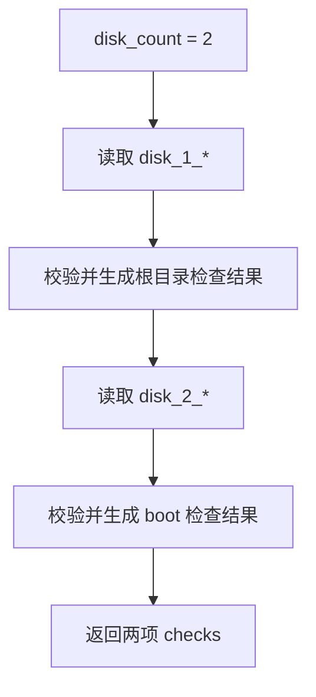

其他模块采用类似形式：

| 模块 | 记录字段示例 | 数量字段 |
|---|---|---|
| 磁盘 | `disk_1_mount` | `disk_count` |
| 必需进程 | `required_1_name` | `required_count` |
| 服务 | `service_1_name` | `service_count` |
| TCP 监听 | `tcp_listener_1` | `tcp_listener_count` |
| 系统错误日志 | `system_error_entry_1` | `system_error_entry_count` |

分析函数会按约定核对数量、名称和必要字段，避免把缺失的数据当作正常。

### 日志数据有两层解析

```text
system_error_entry_1={"PRIORITY":"3","MESSAGE":"Example error"}
```

第一层由 `collector.py` 处理：

```text
字段名 → system_error_entry_1
字段值 → 一段 JSON 字符串
```

第二层由 `log_analyzer.py` 处理：

```text
JSON 字符串 → Python 字典 → 提取 PRIORITY、MESSAGE 等字段
```

采集器不负责理解日志消息内容。

## 6. 各主要文件内部怎样工作

### 6.1 server_check.sh：启动与记录

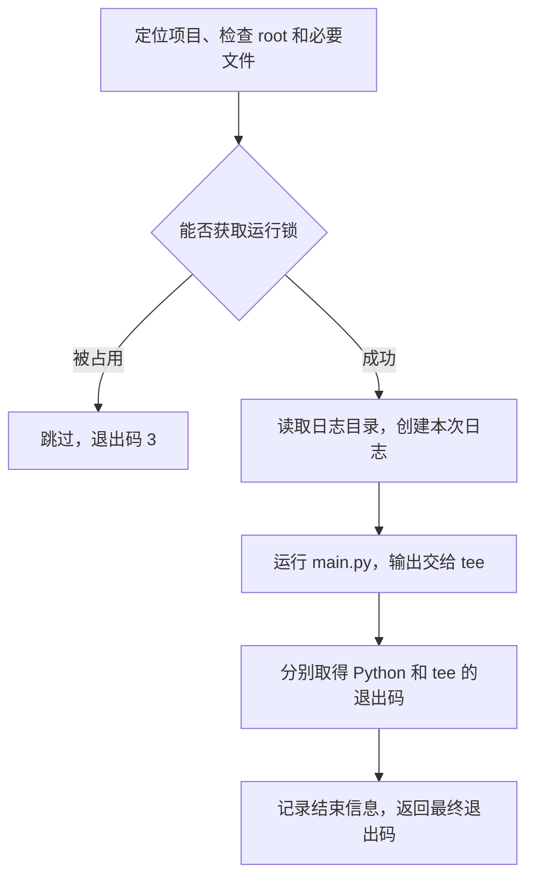

关键点：

- 使用 `.venv/bin/python`，不依赖用户是否激活虚拟环境。
- 使用 `flock` 防止通过同一入口重复运行。
- 使用 `tee` 同时显示和保存输出。
- 使用 `PIPESTATUS` 分别判断 Python 与日志写入是否成功。
- 锁文件存在不代表锁被占用；锁由内核管理。
- 直接运行 `main.py` 会绕过这里的运行锁。

### 6.2 main.py：组织全部检查

| 函数 | 内部简单逻辑 |
|---|---|
| `validate_output_config()` | 检查报告目录配置类型和内容 |
| `inspect_system_info()` | 采集基本信息，检查必要字段，返回主机信息与检查项 |
| `inspect_resources_and_services()` | 顺序检查 CPU、内存、磁盘、配置的进程和服务 |
| `inspect_network_security_logs()` | 顺序调用网络、安全、日志分析 |
| `main()` | 验证配置、合并结果、保存报告、打印汇总并返回状态 |

进程或服务名单为空时，跳过对应采集，不添加虚假的 PASS 记录。

### 6.3 collector.py：执行和解析

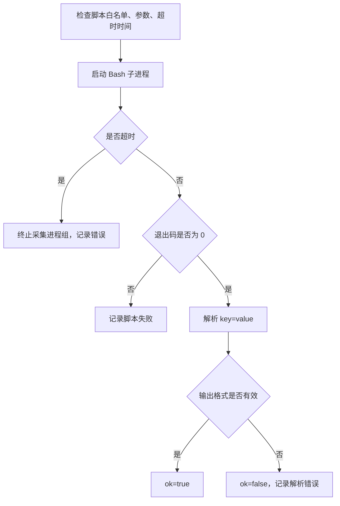

`parse_output()` 负责检查：

- 是否存在 `=`。
- 字段名是否为空。
- 字段名是否重复。
- 是否得到有效数据。

采集器采用参数列表启动进程，不把用户参数拼成一整段 Shell 命令执行。

### 6.4 analyzer.py：公共函数和基础分析

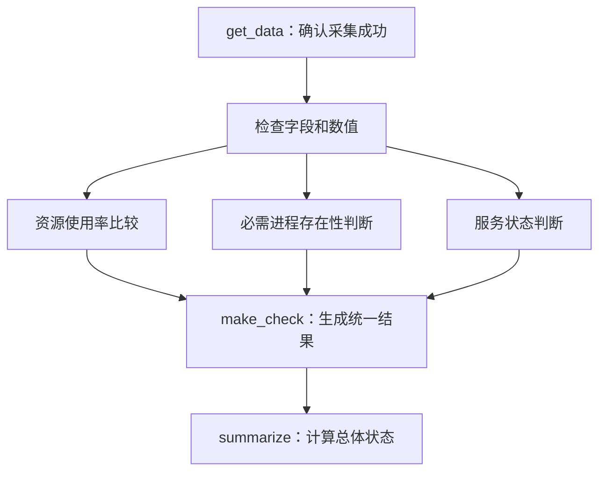

| 函数 | 用途 |
|---|---|
| `load_config()` | 读取 YAML，验证资源阈值、进程、服务、超时等配置 |
| `to_number()` | 转换有限数值，拒绝无效输入 |
| `read_count()` | 读取非负整数字段 |
| `get_data()` | 从成功的采集结果中取得数据 |
| `make_check()` | 创建统一检查字典 |
| `check_usage()` | 按 WARN、FAIL 阈值判断使用率 |
| `analyze_single()` | CPU、内存等单项使用率分析 |
| `analyze_disk()` | 分析多个文件系统并检查根目录 |
| `analyze_process()` | 核对进程名称、数量和存在标记 |
| `analyze_service()` | 核对服务名称及状态字段 |
| `summarize()` | 按 FAIL、WARN、PASS 优先级汇总 |

目前 `analyzer.py` 同时承担基础分析和公共工具职责。

其他分析模块导入其中的公共函数；以后如果模块继续增多，可以考虑拆出公共工具文件，但当前尚未进行这项重构。

### 6.5 network_analyzer.py：TCP 端口规则

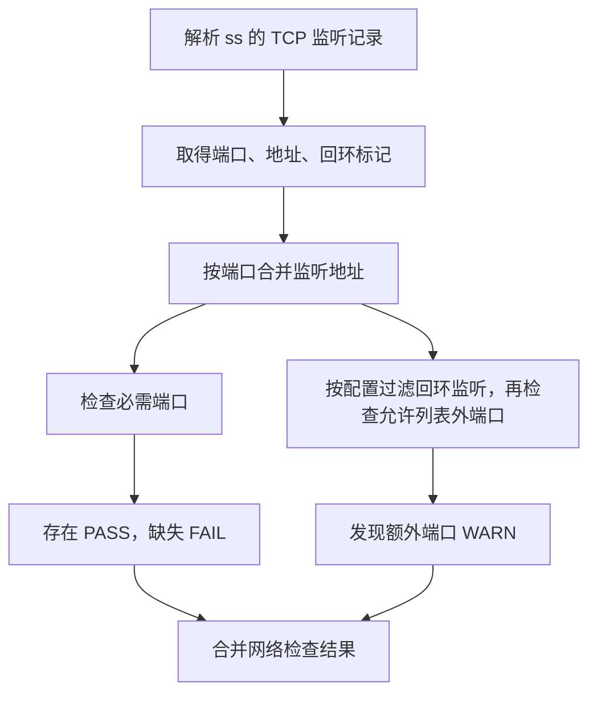

同一个端口可能同时监听 IPv4 和 IPv6，因此一个检查项中的 `endpoints` 可以有多个地址。

必需端口检查与允许列表外端口检查使用的范围不同：

- 必需端口：检查所有采集到的 TCP 监听。
- 允许列表外端口：是否包含回环监听由配置决定。

当前不验证外部可达性，不分析 UDP。

### 6.6 security_analyzer.py：状态与配置告警

| 步骤 | 判断 |
|---|---|
| 验证采集数据 | 失败或字段非法时产生 FAIL |
| firewalld 检查 | 根据运行状态及开关判断是否告警 |
| SSH 配置范围检查 | 必须符合当前约定的全局磁盘配置范围 |
| root 登录检查 | PermitRootLogin 为 yes 且开关开启时 WARN |
| 密码认证检查 | PasswordAuthentication 为 yes 且开关开启时 WARN |
| 补充说明 | 明确未检查运行中配置、Match 条件等限制 |

`PASS` 表示当前规则未触发，不代表完成了全面安全审计。

### 6.7 log_analyzer.py：逐组解析日志

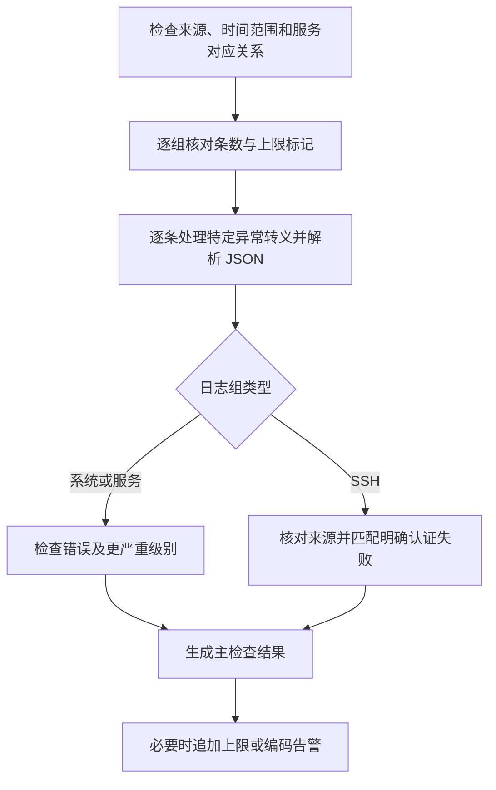

| 函数 | 用途 |
|---|---|
| `validate_log_config()` | 检查服务名单和告警开关 |
| `repair_legacy_escapes()` | 尝试修复已遇到的特定异常转义形式 |
| `parse_entry()` | 解析一条 JSON 日志及 MESSAGE |
| `analyze_group()` | 分析一组日志，生成一项或多项结果 |
| `analyze_logs()` | 组织系统、SSH 和各服务日志分析 |

一组系统错误日志可能生成：

- `system_errors`：错误记录告警。
- `system_errors_encoding`：编码修复告警。
- `system_errors_limit`：达到返回上限的告警。

因此“检查项数量”不等于“日志条数”。

系统错误与服务错误可能包含同一条记录，当前不把各组条数相加当作独立故障总数。

### 6.8 reporter.py：生成并保存报告

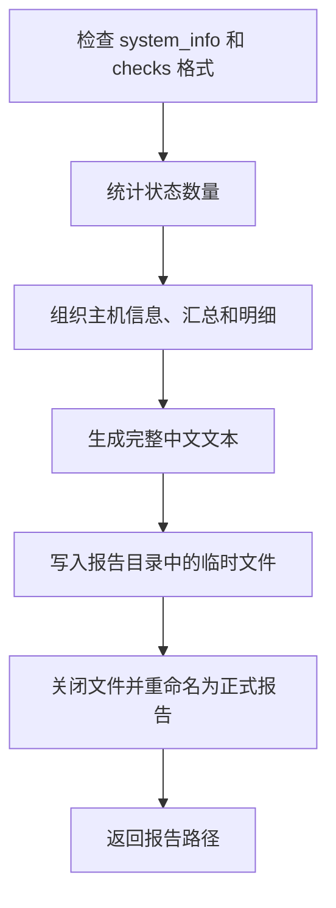

| 函数 | 用途 |
|---|---|
| `display_value()` | 把值转换成适合报告展示的文字，保留中文 |
| `validate_report_data()` | 拒绝空检查列表、非法状态和缺失字段 |
| `render_report()` | 生成报告文本，不写磁盘 |
| `write_report()` | 创建目录、写临时文件、重命名、返回路径 |

临时文件和正式文件位于同一目录，避免读者看到尚未写完的正式报告。

直接运行 `reporter.py` 使用模拟数据；真实巡检由 `main.py` 调用 `write_report()`。

### 6.9 notifier.py：报告之后处理钉钉告警

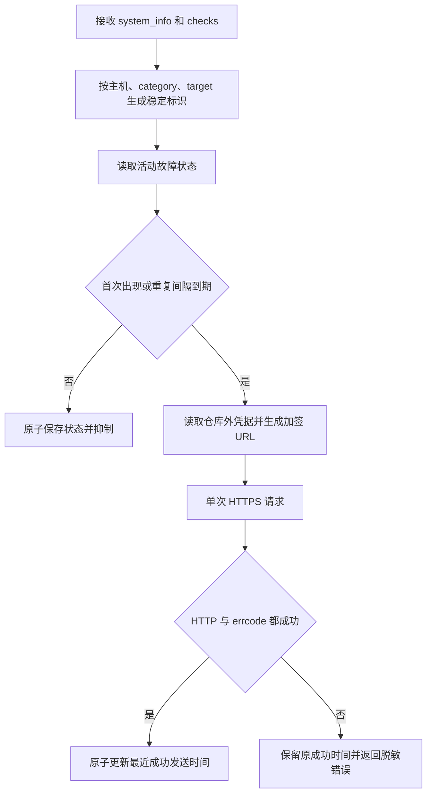

边界说明：

- 通知模块不读取 TXT 报告，也不重新计算阈值。
- 数值和原因不进入故障标识，因此小幅变化不会绕过重复抑制。
- 明确、有实际值的非告警结果才清除活动状态；检查项缺失或值缺失不视为恢复。
- 本阶段不发送恢复通知。
- 状态先写同目录临时文件，再通过 `os.replace()` 原子替换。
- 请求保留系统 CA 的 TLS 证书验证，设置超时且不自动重试。
- `--dry-run` 和 `--test-send` 都使用模拟数据；只有后者发请求，两者都不更新成功发送状态。

### 6.10 cleanup.py：独立维护任务

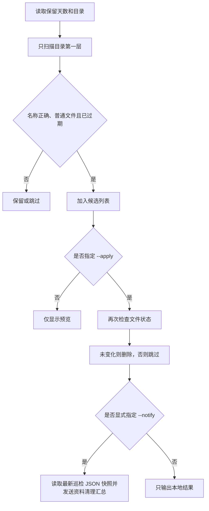

它不参加每次巡检，由独立的 cron 任务调用。

cron 使用 `--apply --notify`，因此会在实际清理后发送汇总。普通手动清理只有显式加入 `--notify` 才发送。通知失败不会回滚已经完成的文件删除，但清理工具会记录错误并返回执行错误码。

过期判断依据文件修改时间，不是文件名中的日期。

## 7. 配置怎样进入各模块

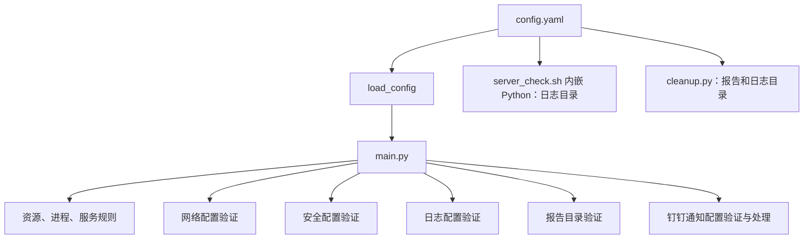

配置由 `main.py` 传给分析函数和通知模块；这些模块不需要为每次处理重复读取 YAML。

注意两类配置的区别：

| 配置 | 生效方式 |
|---|---|
| `config.yaml` | 新一次运行读取 |
| `inspector.cron` | 安装到 `/etc/cron.d/` 后生效 |
| `inspector.logrotate` | 安装到 `/etc/logrotate.d/` 后被系统读取 |

当前 cron 入口日志和 logrotate 使用固定路径。更改 YAML 中的输出目录，不会自动修改这些部署文件。

## 8. 状态和错误怎样传递

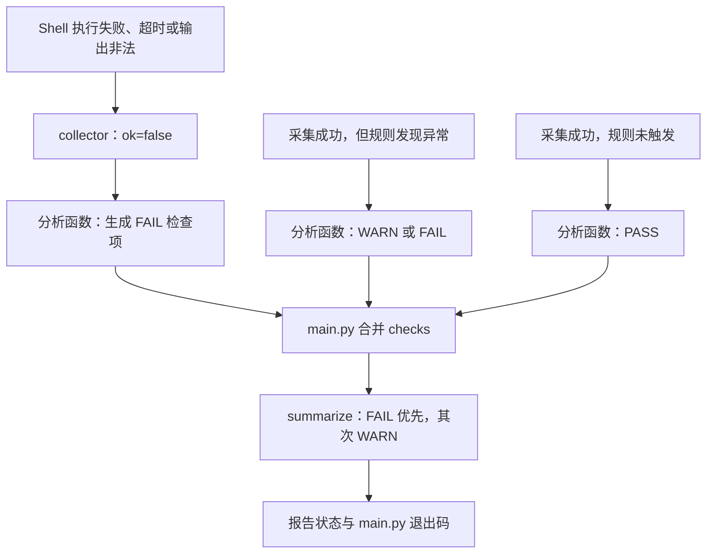

| 层次 | 状态含义 |
|---|---|
| Shell 退出码 | 采集命令执行是否成功 |
| `collected.ok` | 执行及输出解析是否成功 |
| `check.status` | 一项检查是否符合规则 |
| `overall_status` | 全部检查结果的汇总 |
| 启动脚本退出码 | 巡检状态以及入口执行情况 |

完整入口的退出码：

| 退出码 | 含义 |
|---:|---|
| 0 | PASS |
| 1 | WARN |
| 2 | FAIL 或执行错误 |
| 3 | 巡检锁被占用，本次跳过 |

配置错误可能在采集前终止运行；报告保存失败可能在分析完成后终止运行。

当前不是所有未预期异常都会转换成检查项。遇到程序异常时，应查看运行日志中的错误或 Traceback。

## 9. 报告、运行日志和系统日志的区别

| 数据 | 来源 | 作用 |
|---|---|---|
| 系统 journal 日志 | Linux 和各服务 | 巡检要分析的原始记录 |
| `inspection_*.txt` | `reporter.py` | 本次巡检的分析报告 |
| `run_*.log` | `server_check.sh` | 本次程序执行过程 |
| `cron_launcher.log` | cron 输出重定向 | 定时启动的累计输出 |
| `cleanup_launcher.log` | 清理任务输出重定向 | 清理任务的累计输出 |
| `runtime/latest_inspection.json` | `main.py` 原子写入 | 最近成功保存报告后的主机信息与检查结果 |
| `runtime/dingtalk_alert_state.json` | `notifier.py` 原子写入 | 活动故障及最近成功发送时间 |

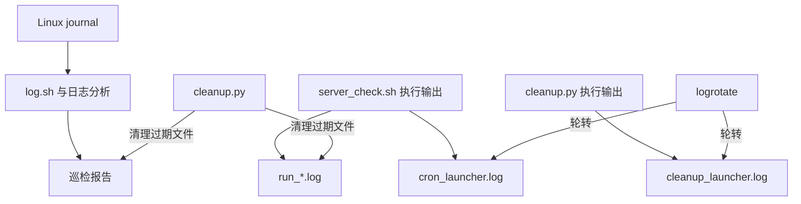

巡检保留策略：

- 正式报告、单次运行日志：清理工具按 7 天修改时间期限处理。
- 两个入口累计日志：logrotate 按日规则轮转，最多保留 7 份历史文件。
- 系统 journal：本项目不负责清理。
- 原始采集数据：目前没有统一完整归档功能。

## 10. 新增功能时应该改哪里

以未来增加“磁盘 inode 使用率检查”为例，下面是扩展步骤，不表示当前已经实现。

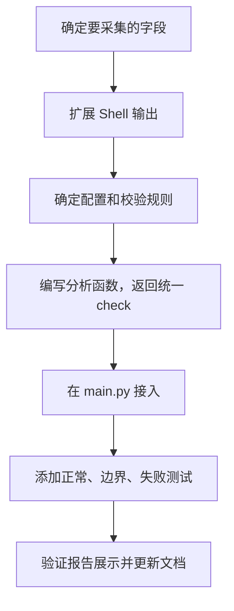

| 变化 | 需要修改的位置 |
|---|---|
| 现有脚本新增数据字段 | 对应 `scripts/*.sh` |
| 新增独立采集脚本 | 新脚本，以及 `collector.py` 白名单 |
| 新增阈值或开关 | `config.yaml` 和配置校验函数 |
| 新增判断逻辑 | 对应分析模块，必要时新增模块 |
| 让功能参加完整巡检 | `main.py` |
| 新增检查分类的中文名称 | `reporter.py` 的分类映射 |
| 验证规则正确 | `tests/` |
| 对外说明新功能 | README 和相关文档 |

只要继续返回包含五个标准字段的检查结果，报告模块通常可以直接展示。

不要把业务阈值判断放进 `collector.py`，否则采集器会越来越难复用。

## 11. 当前测试覆盖与架构边界

| 范围 | 当前验证方式 |
|---|---|
| 资源、进程、服务和日志分析 | `unittest` 自动发现并执行现有测试 |
| 钉钉故障通知与资料清理通知 | 模拟 HTTPS、临时状态文件和消息内容断言 |
| 文件清理 | 临时目录内验证预览、删除、跳过和统计 |
| Shell 文件 | `bash -n` 语法检查 |
| 网络、安全、报告与完整调度 | 已进行实际运行验证 |
| 每分钟巡检及运行锁 | 已进行实际验证 |
| 日志轮转 | 配置调试检查通过 |

测试数量以自动发现命令当次输出为准。目标 Linux 主机已完成钉钉显式测试发送并确认收到；每日 20:40 清理汇总是否自动触发、系统实际轮转和压缩，仍以对应运行日志和实际产物确认。

当前架构的主要边界：

- 单机、顺序执行，未实现多主机调度。
- 定时采样，不是连续实时监控。
- 没有统一数据库和完整原始数据归档。
- 钉钉告警支持活动故障去重和间隔提醒，但不发送恢复通知，也不自动修复。
- 没有为所有模块配置独立单元测试。
- 报告和检查结果说明的是本次规则覆盖范围，不代表全面健康或安全保证。
